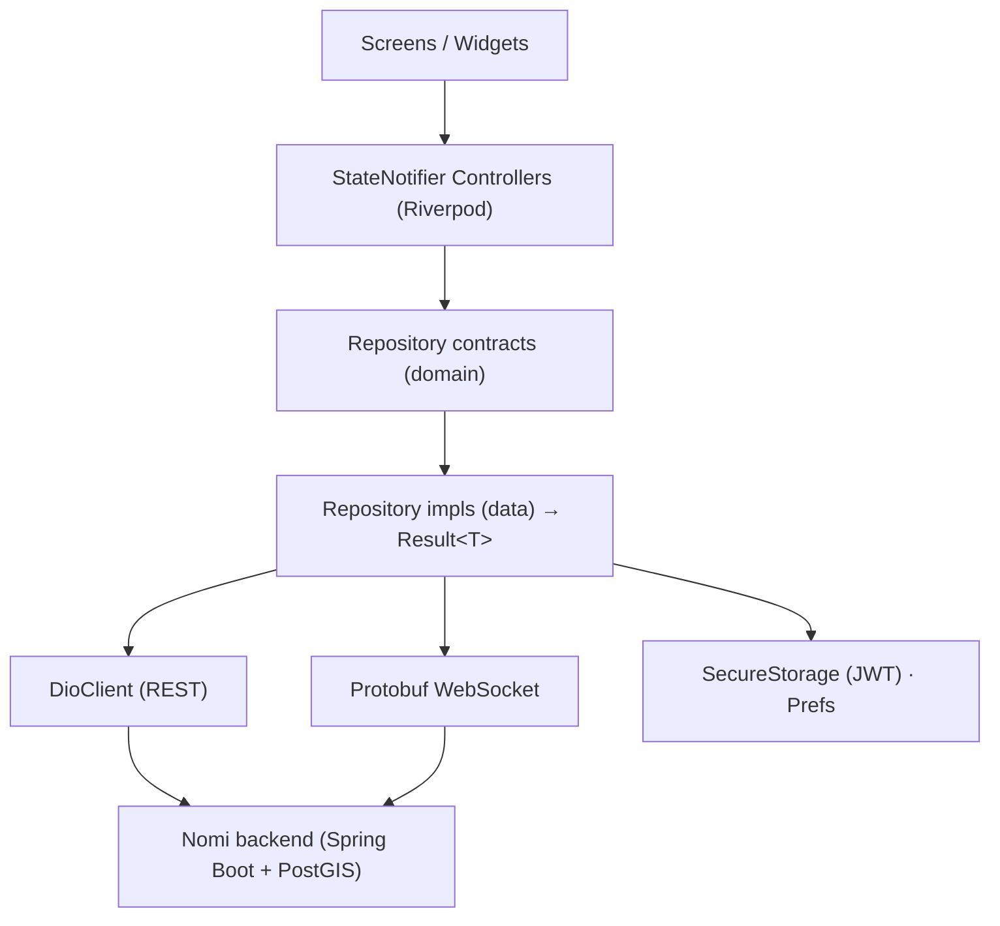
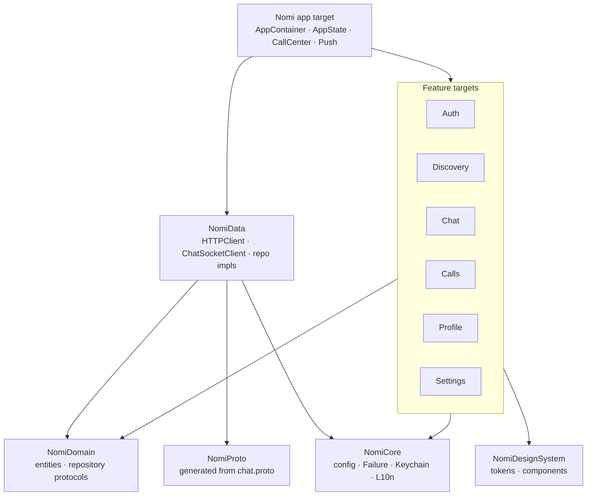

<h1 align="center">Nomi</h1>

<p align="center">
  <strong>Location-based social discovery app. Find people nearby, chat in real time, and start an audio or video call</strong><br/>
  <sub>A two-person product. I build both mobile clients, a Flutter app for Android and a native Swift/SwiftUI app for iOS. My co-founder builds the Spring Boot + PostGIS backend.</sub>
</p>

<p align="center">
  
  
  
  
  
</p>

---

## Table of Contents

- [Two Apps, One Product](#two-apps-one-product)
- [Features](#features)
- [Android: Flutter](#android-flutter)
- [iOS: Native Swift / SwiftUI](#ios-native-swift--swiftui)
- [Shared Contract](#shared-contract)
- [Engineering Highlights](#engineering-highlights)
- [Privacy & Permissions](#privacy--permissions)
- [Project Status](#project-status)
- [Author](#author)

---

## Two Apps, One Product

Nomi started as a single Flutter app for both platforms. Android stays on Flutter. On iOS I am rebuilding the app natively in Swift and SwiftUI, one feature at a time, against the same backend. The Flutter iOS build keeps shipping until the native app reaches parity, so the switch never needs one big cutover.

| | Android | iOS |
|---|---|---|
| **Stack** | Flutter 3.47 · Dart 3.12 | Swift · SwiftUI · iOS 17+ |
| **Architecture** | Feature-first Clean Architecture + Riverpod | Clean Architecture + MVVM (`@Observable`), one SwiftPM target per layer |
| **Size** | ~470 Dart files | ~230 Swift files, ~28.7k lines |
| **Tests** | 277 test files (unit, widget, accessibility) | 330+ Swift Testing tests |
| **UI tests** | Maestro flows | The same Maestro flows, run against the native build |

The two apps share **contracts, not code**: the Protobuf schema, the API envelope, encryption test vectors, design tokens, translations, and the end-to-end flows.

---

## Features

Both apps cover the same product:

- **Auth & onboarding**: email registration with a verification code, login, password reset and change, then a four-step profile setup (photo, basics, interests, what you're looking for)
- **Discovery**: a pre-permission location explainer, a nearby feed backed by PostGIS proximity queries, distance and gender filters, recommendations, and user search
- **Real-time chat**: binary **Protobuf over WebSocket**. Text, multi-image with crop and caption, reply, edit, delete, read receipts, typing, mentions, voice messages, group chats with roles, an offline outbox, and a cached history so chats open instantly
- **Audio & video calls**: 1-on-1 WebRTC calls signaled over the chat socket, with busy handling and call records
- **Profile & settings**: profile editing, a photo gallery, interest tags, QR profile codes and deep links, privacy toggles, blocked users, light/dark themes and animated chat backgrounds
- **Push**: Firebase Cloud Messaging for messages and session revocation
- **Localization**: English and Khmer, with a bundled Noto Sans Khmer font so Khmer renders the same on every device

---

## Android: Flutter

| Layer | Choice |
|---|---|
| **State & DI** | Riverpod (`StateNotifier` controllers + immutable state) |
| **Navigation** | GoRouter |
| **Networking** | Dio with auth, logging and payload-encryption interceptors. Sealed `Result<T>` / `Failure` |
| **Realtime** | `web_socket_channel` + Protocol Buffers |
| **Calls** | `flutter_webrtc` |
| **Storage** | `flutter_secure_storage` (JWT), `shared_preferences` |
| **Push / Crash** | Firebase Cloud Messaging, `flutter_local_notifications`, Crashlytics |
| **Codegen** | `freezed`, `json_serializable`, `build_runner`, `protoc` |
| **Quality** | `very_good_analysis` (strict), `mocktail`, `fake_async` |



```
lib/
├── main.dart          # Thin entrypoint → bootstrap()
├── bootstrap.dart     # Error zone, Firebase + FCM, storage, ProviderScope overrides
├── app/               # MaterialApp.router + GoRouter
├── core/              # config, network, error, storage, proto, logging
├── design_system/     # tokens (palette, typography, spacing) + shared widgets
└── features/          # auth, onboarding, discovery, chat, calls, profile, settings, home…
    └── <feature>/
        ├── domain/        # entities · repository contracts
        ├── data/          # DTOs · data sources · repository impls
        └── presentation/  # controllers + state · screens · widgets
```

**CI** runs on every push and PR: `dart format` → `flutter analyze` → a design-token guard → an image-caching guard → `flutter test --coverage`.

---

## iOS: Native Swift / SwiftUI

Apple frameworks first. A third-party package is added only where Apple has no equivalent.

| Layer | Choice |
|---|---|
| **UI** | SwiftUI, `NavigationStack` per tab, `NavigationSplitView` for chats on iPad |
| **State & DI** | `@Observable` view models holding an immutable `State`. An `AppContainer` composition root |
| **Networking** | `URLSession` + async/await behind an `HTTPClient` middleware chain (auth, language, encryption, logging with credential redaction) |
| **Realtime** | `URLSessionWebSocketTask` + `swift-protobuf`, heartbeat and exponential-backoff reconnect |
| **Calls** | Google WebRTC, **CallKit + PushKit** so calls ring even when the app is killed |
| **Media** | `PhotosPicker`, a custom crop & rotate editor, ImageIO downsampling, `AVAudioRecorder` / `AVAudioPlayer` for voice messages |
| **Location** | CoreLocation |
| **Storage** | Keychain wrapper, `UserDefaults` |
| **Push / Crash** | Firebase iOS SDK (Messaging, Crashlytics, Analytics), `UNUserNotificationCenter` |
| **Quality** | Swift Testing, SwiftLint with custom design-token rules |

The logic lives in one local Swift package, **NomiKit**, with one target per layer. A target can only import what `Package.swift` declares, so the compiler enforces the layering: features never touch `NomiData` or each other.



**What changed from Flutter on iOS:**

- **CallKit + PushKit.** The Flutter build has no CallKit. Natively, VoIP pushes ring the system call UI even with the app killed.
- **iPad split view** shows the chat list beside the open conversation.
- **A minimized call** becomes a bar above the tabs for voice, or a draggable floating tile for video.
- **Memory.** Images decode at the size they're shown. A 56-pt avatar from a 2000-px photo drops from ~16 MB to ~0.1 MB in the cache.
- **Accessibility.** Every icon-only button has a VoiceOver label, and layouts were checked with Dynamic Type at the largest size in Khmer.

---

## Shared Contract

Native iOS is a second implementation, so the risk is drift. Each shared input has one source of truth, and the iOS side is **generated** from it. A check script fails the build when any generated file is out of date.

| Shared input | Source of truth | Consumed by |
|---|---|---|
| Chat & signaling schema | `chat.proto` | Generated Dart and generated Swift |
| Strings (English + Khmer) | Dart string tables | Generated `Localizable.strings` |
| Palette & icon font | Dart design tokens | Generated `Palette.swift`, `NomiIcon.swift` |
| Payload encryption | Dart codec | Test vectors that the Swift codec must match byte for byte |
| User journeys | Maestro flows | Run against both apps |

**Seamless upgrade.** The native app uses the same bundle ID, so an App Store update replaces the Flutter build in place. At launch it reads the token that the Flutter plugin wrote to the Keychain, and it shares every `UserDefaults` setting under the same keys (theme, drafts, the outbox, flags). Users stay signed in, and their unsent messages survive the switch in either direction.

---

## Engineering Highlights

- **Legacy-to-Clean migration on Flutter.** The app started as `lib/screens/` plus singleton services. I moved every feature onto feature-first Clean Architecture with Riverpod and deleted the old layers.
- **Incremental native rewrite.** The iOS rewrite happens in phases (foundations, auth, profile, discovery, chat, calls), each ending with green tests and a working build against the real backend. The Dart code is the spec: the iOS side ports test cases, not test code.
- **One socket for chat and calls.** Calls reuse the connection, auth and reconnect logic that messaging already proved.
- **Explicit errors.** Both apps use a typed `Result` + sealed `Failure`, mapped to user-facing states in one place.
- **Design system enforced in tooling.** A CI script on Flutter and a SwiftLint rule on iOS reject raw colors and spacing in feature code.
- **Mock backend in both apps.** The dev build runs entirely on mock data, including a mock chat server and mock call media, so every screen can be exercised offline.

---

## Privacy & Permissions

- **Location**: nearby discovery and distance filtering, behind an in-app explainer shown before the system prompt
- **Camera & microphone**: calls, photo capture, voice messages
- **Photo library**: avatar and gallery uploads, saving received images
- **Notifications**: push for messages and calls
- **Credentials**: JWTs live only in the Keychain / secure store. No secrets are in the repo

---

## Project Status

🚧 **Pre-release, not yet public.**

- **Android (Flutter):** core MVP feature-complete. Auth, discovery, chat, calls, profile, settings and push all work against the live backend.
- **iOS (native):** auth, onboarding, profile, settings, discovery, notifications, chat and calls are built. Remaining before it replaces the Flutter iOS build: a real two-phone call test, the on-device upgrade test, and the last end-to-end flows.

---

## Author

**Sok Pich** ([@sokpichdev](https://github.com/sokpichdev))
<sub>Co-founder and mobile lead on a two-person team. I build the Android and iOS apps, my partner builds the backend.</sub>
